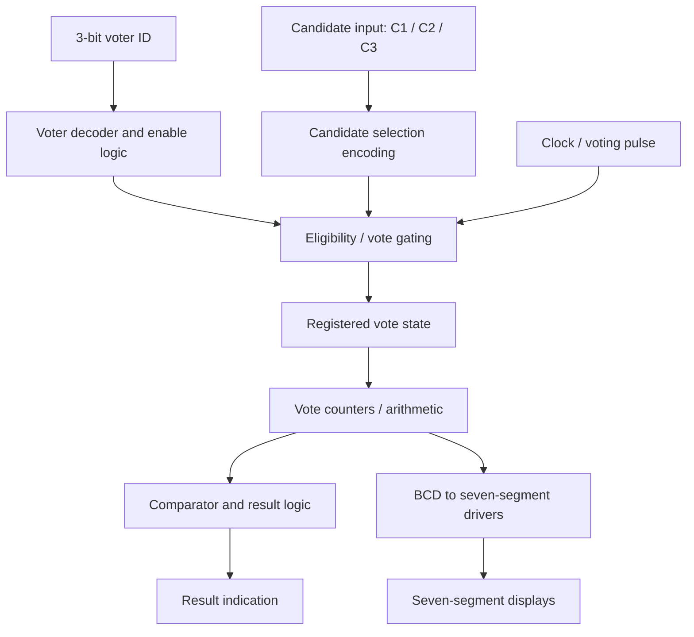

# Digital Vote Casting System

**Digital Logic Design | Proteus Simulation | Breadboard Hardware Prototype | November–December 2022**


## Project overview

I designed and built a **digital vote casting system** using combinational and sequential logic. My project demonstrates a structured voting process in which voters are represented by unique binary IDs, a candidate is selected, and the vote is processed through logic circuits. I developed a Proteus schematic and assembled a working breadboard prototype with integrated circuits, wiring and seven-segment displays.

The design combines **3-bit voter identification**, decoder and encoder logic, gating and registers, arithmetic processing, comparison, a clock signal and BCD-to-seven-segment display interfaces. Three candidates are represented as **C1, C2 and C3**. The overall goal was to apply fundamental digital-electronics concepts to a recognizable real-world workflow.


## Project highlights

- Designed a multi-stage voting architecture using standard digital-logic building blocks.
- Used **3-bit binary voter identifiers**, representing IDs **000–100** (five example IDs).
- Integrated voter decoding, selection logic, register-based state storage and clock-controlled updates.
- Used arithmetic and comparison stages for vote processing and result evaluation.
- Connected BCD-to-seven-segment driver circuitry to numerical displays.
- Assembled the design on breadboards using logic ICs, seven-segment displays and jumper wiring.
- Tested the logic through circuit simulation and physical prototyping.

## System photographs

| Proteus logic schematic | Breadboard implementation |
|:---:|:---:|
|  |  |

*The photographs show the system I designed and assembled. The display states in the photos are demonstration states, not documented final election totals.*

## System architecture



### 1. Voter identification

I used three binary inputs to represent a voter ID. The IDs in my project description run from **000 to 100**, corresponding to five possible registered inputs. Decoder logic converts a binary code into a selected output line, making it possible to control a voter-specific path with simple digital gates.

| Decimal voter ID | Binary input |
|:--:|:--:|
| 0 | `000` |
| 1 | `001` |
| 2 | `010` |
| 3 | `011` |
| 4 | `100` |

### 2. Candidate selection

A candidate selection path routes the user's choice to the voting logic. I used the candidate labels **C1**, **C2**, and **C3**. Encoders and logic gates translate the selected input into a binary representation that can be registered and processed.

| Candidate | Encoded value in the reference implementation |
|:--|:--:|
| C1 | `00` |
| C2 | `01` |
| C3 | `10` |

### 3. Voting clock and registers

The clock coordinates state changes. A register retains the recorded voting state between clock events, separating a momentary input signal from the persistent value used by counting and decision logic. The reference RTL included below models a vote being registered on a rising clock edge.

### 4. Vote counting and arithmetic

The voting system uses binary arithmetic to aggregate votes. A counter is a sequential circuit that updates its stored number after a valid event; binary adder logic can be used to implement the increment operation. Separate counts allow candidate totals to be represented independently.

### 5. Comparison and result indication

The comparator stage compares stored vote totals to identify the leading count. If two or more candidate totals are equal to the maximum, the corresponding candidates are tied. The included reference RTL reports the leading candidate and a tie flag.

### 6. BCD and seven-segment output

The schematic and breadboard use seven-segment displays to visualize numerical values. In this type of design, a decoder translates a four-bit BCD digit into control signals for seven LED segments (`a` to `g`). Segment wiring depends on whether the display is **common-anode** or **common-cathode**. The software reference below assumes active-high segments for a common-cathode representation.

## Main hardware and logic blocks

| Block | Role |
|:--|:--|
| Digital logic ICs | Perform decoding, encoding, storage, arithmetic and comparison functions |
| Binary inputs / switches | Represent voter IDs and candidate selection |
| Logic gates | Combine valid voter signals, selection signals, and timing conditions |
| Clock generator | Creates sequential update events |
| Registers / flip-flops | Store logic state across events |
| Binary adders and comparators | Process candidate counts and compare totals |
| BCD-to-seven-segment decoder/driver | Drive the display segments |
| Seven-segment LED displays | Display numeric states and values |
| Breadboards, jumper wires, power rails | Build and interconnect the hardware prototype |
| Proteus | Create and simulate the electronic schematic |

## Reference behavior and examples

The following table illustrates the digital vote-counting behavior implemented in the accompanying RTL. It is a **reproducible verification scenario**, rather than a measurement of values in the project photos.

| Event | Voter ID | Selected candidate | C1 | C2 | C3 | Outcome |
|:--|:--:|:--:|--:|--:|--:|:--|
| Reset | — | — | 0 | 0 | 0 | Registers cleared |
| Vote | 000 | C1 | 1 | 0 | 0 | Accepted |
| Vote | 001 | C2 | 1 | 1 | 0 | Accepted |
| Vote | 010 | C1 | 2 | 1 | 0 | Accepted |
| Duplicate attempt | 000 | C3 | 2 | 1 | 0 | Ignored |
| Vote | 011 | C3 | 2 | 1 | 1 | Accepted |
| Vote | 100 | C2 | 2 | 2 | 1 | Accepted; C1/C2 tie |

## Reproducible digital model

I included an additional **Verilog reference implementation** that expresses the main architectural concepts as synthesizable digital logic. It offers a readable way to explore the register-based vote flow outside the original Proteus schematic. The `rtl/` implementation is an accompanying reconstruction; the original project was created in Proteus and assembled on breadboards.

**RTL functionality:** voter IDs `000`–`100`, three candidate selections, a clock-enabled voting event, one accepted vote per voter ID, independent eight-bit candidate counters, leading-candidate indication, tie detection, and a decimal display-encoding helper.

### Run a simulation

Install [Icarus Verilog](https://steveicarus.github.io/iverilog/) and run:

```bash
iverilog -g2012 -o voting_sim rtl/vote_casting_system.v rtl/seven_segment_decoder.v simulation/tb_vote_casting_system.v
vvp voting_sim
```

The testbench checks reset, accepted votes, duplicate rejection, invalid voter IDs, invalid candidate codes, totals and tie detection. For a Python-only check, run:

```bash
python -m unittest discover -s tests -v
```

## Repository structure

```text
vote-casting-system/
├── README.md
├── LICENSE
├── .gitignore
├── assets/
│   ├── proteus-schematic.png
│   ├── breadboard-prototype.png
│   └── project-description.png
├── rtl/
│   ├── vote_casting_system.v
│   └── seven_segment_decoder.v
├── simulation/
│   └── tb_vote_casting_system.v
├── tests/
│   └── test_reference_model.py
└── docs/
    ├── circuit-walkthrough.md
    ├── testing-and-demonstration.md
    └── github-upload-guide.md
```

## Skills demonstrated

**Digital Logic Design · Boolean Logic · Combinational Circuits · Sequential Circuits · Voter Decoding · Encoding · Flip-Flops and Registers · Counters · Binary Arithmetic · Comparator Logic · BCD Decoding · Seven-Segment Displays · Proteus · Breadboard Prototyping · Digital Circuit Verification · Verilog**

## Project timeline

**November 2022 – December 2022**

## Author

Designed and developed as my **Digital Logic Design vote casting system project**.
