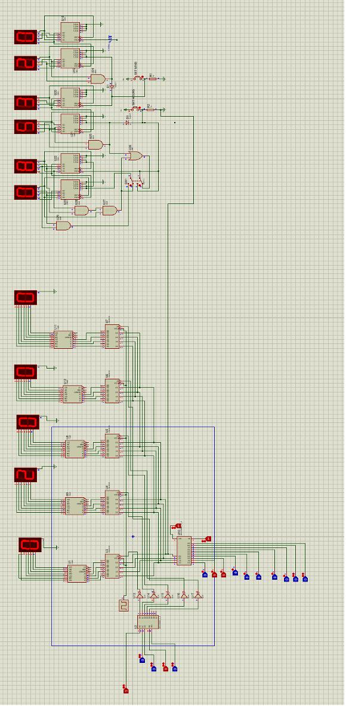
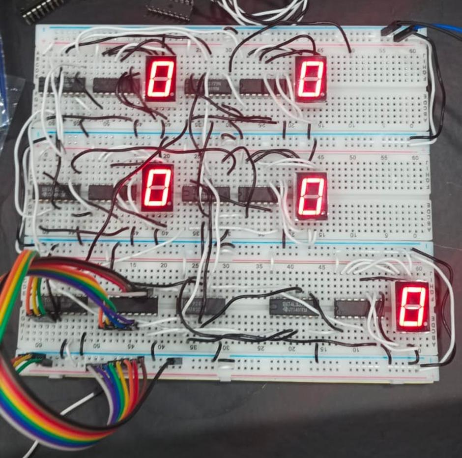

# Circuit walkthrough

## Proteus design

The schematic is organized into upper input/decoding logic and lower arithmetic, display, and control logic. Multiple red seven-segment indicators are distributed along the left side. Logic-gate symbols, IC packages, switch inputs, and wiring converge toward the right-side control and indication signals.

**Signal flow:** binary voter ID → decoding/enable logic → candidate selection → clocked register(s) → counting/arithmetic → comparison → display-driver logic → seven-segment output.

### Building blocks

1. **Binary voter encoding:** 3 wires can represent eight combinations; the documented project uses `000` through `100`.
2. **Decoder:** asserts one selected line associated with the binary ID.
3. **Encoder and selection gates:** produce a compact candidate code from the choice inputs.
4. **Clock:** provides a discrete event at which data is captured.
5. **Register:** retains stable values even when inputs change later.
6. **Adder/counter:** increments a total after an accepted vote.
7. **Comparator:** evaluates the relative magnitude of candidate totals.
8. **BCD/seven-segment driver:** converts numerical digit codes into segment signals.

## Breadboard build

The prototype uses **three interconnected breadboards** with visible DIP-format ICs, jumper wire connections, power buses and **five illuminated seven-segment displays**. The wiring shows multiple functional subassemblies linked using ribbon-style jumper connections.

## Practical wiring checklist

- Confirm each IC's pinout from its datasheet before supplying power.
- Use the voltage specified for each logic-family IC; never assume IC families are interchangeable.
- Join compatible ground references and avoid floating control inputs.
- Include suitable current-limiting resistors for seven-segment LED segments.
- Match display type and segment pinout to its decoder/driver.
- Debounce mechanical switches or produce a clean clock pulse to avoid recording multiple events.
- Check logic signal propagation and stable inputs before a register's active clock edge.
- Verify data paths with a logic probe or oscilloscope before connecting all stages.

## Display notes

BCD encodes decimal digits `0` through `9` using four-bit patterns. The helper module at `rtl/seven_segment_decoder.v` maps the four-bit value to a generic common-cathode active-high `abcdefg` pattern. Real displays require the correct power, pin mapping, resistors, and possibly active-low inversion.
